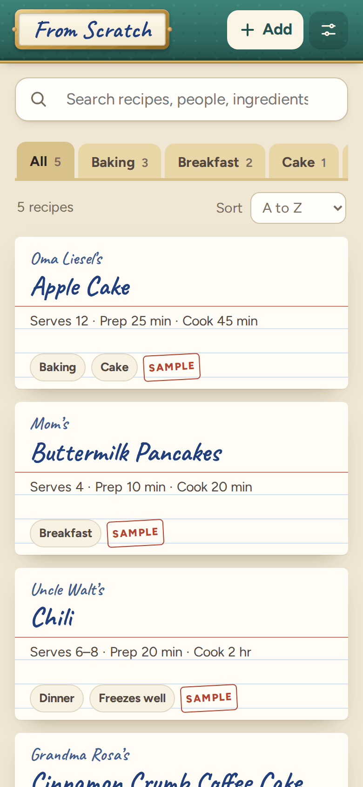
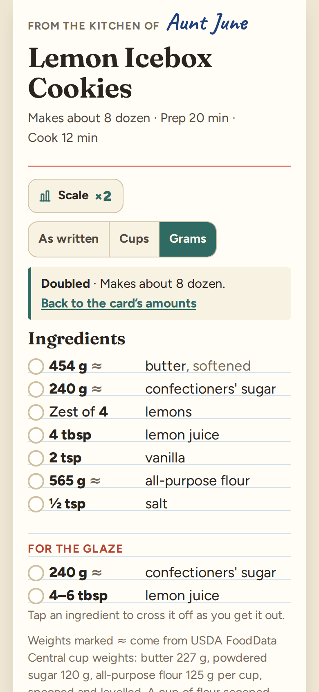
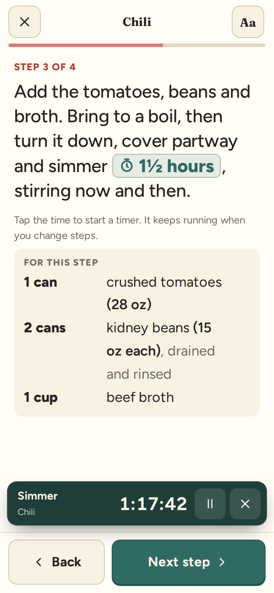
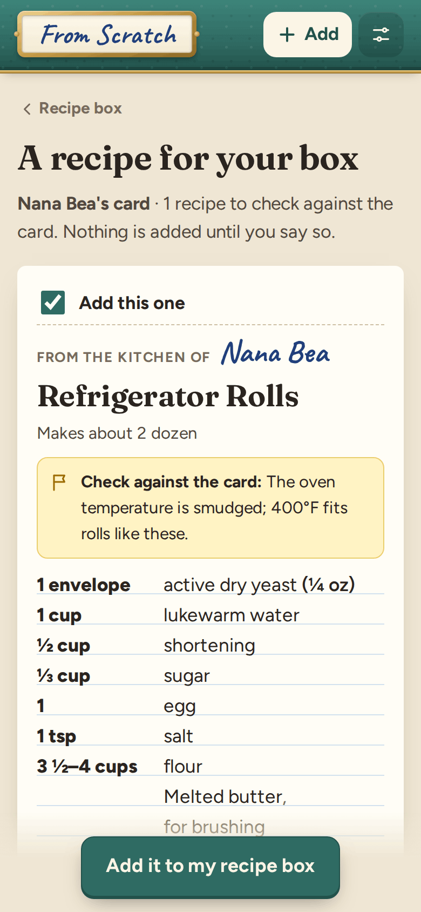

# From Scratch

**Use it: [junkdrawer.works/from-scratch](https://junkdrawer.works/from-scratch/)**

**The family recipe box.** Keep the recipes that live on stained index cards and in people's heads, with whose they
are. Photograph a card and Claude types it up; then scale it, switch between cups and grams, and cook from it with the
screen kept on. It syncs across your own devices through Google Drive, and a recipe can be sent to family as a link.

<p align="center">
  
  &nbsp;
  
  &nbsp;
  
  &nbsp;
  
</p>

<sub>Screenshots use the five sample recipes, from a made-up family.</sub>

## How it works

- **A recipe box.** Each recipe is an index card with whose it is ("From the kitchen of Grandma Rosa"), what it serves
  or makes, the times, the ingredients in sections ("For the glaze"), the steps, notes and stories in handwriting, tags,
  and where it came from. Search reads everything, ingredients included, so "buttermilk" finds the pancakes. Tags are
  the box's divider tabs, and the box sorts by name, by whose, or newest.
- **Photograph a card, and Claude types it up.** The skill in `skill/from-scratch-cards/` tells Claude how to read old
  cards: handwriting, "c." and "T." and "t.", oleo, a scant cup, butter the size of an egg, a moderate oven, old can sizes.
  Claude hands back a link. Opening it shows the recipes to check against the card, with anything Claude wasn't sure
  of flagged, and nothing is added until you say so. The same link opened twice adds nothing twice.
- **Or type it in, or paste it.** The form shows how each ingredient line reads as you type ("2 c. sugar" → 2 cups,
  sugar), keeps a draft if you leave, and takes a photo of the original card. Paste a whole recipe from an email or a
  website and it's sorted into the name, ingredients, steps and notes for you to check.
- **Scale it** by how much (½, 1½, 2, 3 or your own), by servings ("serves 12 instead of 6"), or by what you have
  ("I only have 3 eggs"). Amounts come out in kitchen fractions and the easiest measure: 16 tablespoons become a cup,
  3 teaspoons a tablespoon, half of ⅓ cup is 2 tbsp + 2 tsp. Eggs say how to use half of one. Can sizes, times and pan
  sizes stay as they are, and it says so when a step has amounts of its own.
- **Cups or grams.** "Cups" shows cups, spoons, ounces and pounds; "Grams" weighs flour, sugars, butter, oats, rice,
  cocoa, honey, nuts and other baking staples by their USDA FoodData Central cup weights (every figure has its NDB number
  in `js/density.js`), turns other cups into millilitres, and leaves teaspoons as spoons. Oven temperatures and pan sizes
  in the steps convert too (350°F → 180°C, 9x13-inch → 23 × 33 cm). Anything without a USDA weight keeps its cups.
- **Cook mode**: one step at a time in large type, the ingredients that step uses right under it, and the screen kept
  on with the Screen Wake Lock. Swipe, tap or use the arrow keys to move between steps.
- **Timers.** Every time in a step ("bake 25–30 minutes", "simmer 1½ hours") is a button that starts a timer. Timers
  keep going between steps, outside cook mode and through a reload, and ring with beeps and a buzz. A range times the
  low end and says what the card allows.
- **Send it to family.** A recipe goes as a link, with its notes and whose it is. They open it and save a copy in their
  own box. The recipe travels inside the link, after the #, so nothing is uploaded anywhere.
- **Print it** on a 4 × 6 inch index card, with or without ruled lines (a long one carries on to a second card), or on
  letter or A4 paper with the photo of the card.
- No account and no server. It works offline and installs to a phone's home screen. Save a backup file (with the card
  photos if you like) and load it on another device.

## What's kept where

- **In this browser:** the recipes (localStorage), photos of cards (IndexedDB), and per-device settings: amounts, cook
  mode text size, keeping the screen on, timer sound, and running timers.
- **In your Google Drive, if you turn it on:** the recipes, in one file, `My Drive › From Scratch › From Scratch
  recipes.json`: everything on each recipe card, including notes, tags and any "check against the card" flag, plus
  markers for removed recipes so a removal reaches your other devices.
- **Only on the device where they were added:** photos of cards (they're big; the backup file can carry them), settings
  and timers. Ticks on ingredients and the scale you chose last only while the page is open.

## Sync with Google Drive

It's optional and only offered at junkdrawer.works. Turn it on in **Settings**. From Scratch asks Google for the
narrowest Drive permission there is (`drive.file`): it can see only the folder and file it made, nothing else in your
Drive. It uses the one junkdrawer.works Google sign-in, so signing in to any of the projects there covers the others
for the hour it lasts, and it reads your account's email address to show where it's saving and to skip Google's
account chooser next time.

Each device keeps its own copy and works offline. A sync reads the Drive file, merges it with this device's recipes
one recipe at a time (the most recently changed copy wins, removals included), and writes it back. A device's first
sync loses nothing: the same recipe typed word for word on two devices becomes one, and two copies that differ
anywhere, even only in their notes or tags, both stay. If another device saved in the meantime, it reads again and
merges before writing. Syncs happen a couple of seconds after a change, when you come back to the page,
once a minute while it's open, and when you tap the cloud. The cloud's dot is green when synced, amber while syncing,
and red when Google wants you to sign in again (after an hour); one tap does it.

**Stop saving on this device** stops syncing there and leaves your recipes in place. It doesn't revoke Google's
permission, which would sign every junkdrawer.works project out. To take the permission back, remove junkdrawer.works
under Third-party apps & services in your Google Account, and delete the `From Scratch` folder from Drive if you like.
The [privacy page](https://junkdrawer.works/privacy.html) has the details.

## Typing up cards with Claude

`skill/from-scratch-cards/` is a skill for Claude, and `skill/from-scratch-cards.zip` is the same folder ready to upload
(the Add page links to it). Upload the zip in claude.ai under Settings › Capabilities › Skills (it needs code
execution), then send Claude photos of the cards and say whose they are. It:
1. reads each card, front and back, in her words and her amounts, and flags what it couldn't read;
2. writes the recipes in the format From Scratch reads (`references/format.md`), using `references/old-cards.md` for
   abbreviations, old ingredients, old measures, can sizes and oven temperatures;
3. runs `scripts/make_card_link.py`, which checks the lines and prints the link and a `.fromscratch.json` file.

With a Google Drive connector it can also answer questions about your box by reading the recipe file, which it never
changes. The script runs on its own too:

```sh
python3 skill/from-scratch-cards/scripts/make_card_link.py cards.json
```

A link is `https://junkdrawer.works/from-scratch/#/add/z…`: the recipes as JSON, compressed with raw DEFLATE and
base64url-encoded (`#/add/j…` is the same uncompressed). Recipes sent from From Scratch use the same format.

## Running it

It's a static site: plain HTML, CSS and JavaScript modules, with no build step.

```sh
npx serve .                   # or any static file server, then open the printed address
npm install                   # only for the tools below: esbuild and upng-js
npm test                      # the logic in Node, then the real page in Chromium (needs Playwright)
node tools/screenshots.mjs    # redraws docs/*.png and og.png
node tools/make-icons.mjs     # redraws the PNG icons from icon.svg
node tools/sample-card.mjs    # redraws the made-up photo of Grandma Rosa's card
node tools/skill-zip.mjs      # makes skill/from-scratch-cards.zip again after a change to the skill
npm run build                 # dist/from-scratch.html and dist/artifact.html, the whole app in one file
```

To put it online with GitHub Pages: **Settings → Pages → Build and deployment → Deploy from a branch**, then pick
`main` and `/ (root)`.

### Files

- `js/ingredients.js`: reads an ingredient line into amount, unit, item and note, and writes it back scaled, in kitchen
  fractions and in the easiest measure. `js/units.js`: the units. `js/density.js`: USDA cup weights.
- `js/text.js`: times in steps, oven temperatures and pan sizes, which ingredients each step uses, and splitting a
  pasted recipe. `js/recipe.js`: cleaning recipes, merging boxes, search, yields.
- `js/app.js`: which screen goes with which address, the box, adding, links and settings. `js/recipe-page.js`: a recipe,
  scaling, sending and printing. `js/cook.js`: cook mode. `js/edit.js`: the form and pasting. `js/timers.js`: timers.
  `js/print.js`: printable cards. `js/view.js` and `js/ui.js`: pieces the screens share.
- `js/store.js`: the box and settings in localStorage. `js/photos.js`: card photos in IndexedDB. `js/sync.js`: Google
  Drive. `js/share.js`: links. `js/samples.js`: the five samples, and `samples/rosa-card.jpg`, made by `tools/sample-card.mjs`.
- `skill/from-scratch-cards/`: the Claude skill: `SKILL.md`, `references/` (format, old cards, a worked example) and
  `scripts/make_card_link.py`. `skill/from-scratch-cards.zip` is the folder packed by `tools/skill-zip.mjs`.
- `scripts/build.mjs`: the single-file copy. `fonts/`: Figtree, Fraunces and Caveat, all under the SIL Open Font License,
  served from here so nothing loads from elsewhere. `sw.js`: keeps a copy for using offline.
- `test/unit.test.mjs` checks the parsing (fractions, unicode fractions, ranges, cans, "to taste", old abbreviations),
  scaling, conversions, timers, pasted recipes, merging (including devices syncing in random orders), links, and that
  the skill's script, its format reference, its zip and the page agree. `test/e2e.mjs` uses the page on a phone-sized Chromium:
  the box, scaling, grams, cook mode and timers, typing, pasting, a link from Claude, sending to a second device,
  printing a card and a page, backups, offline, and Google Drive between devices against `test/fake-google.mjs`.
